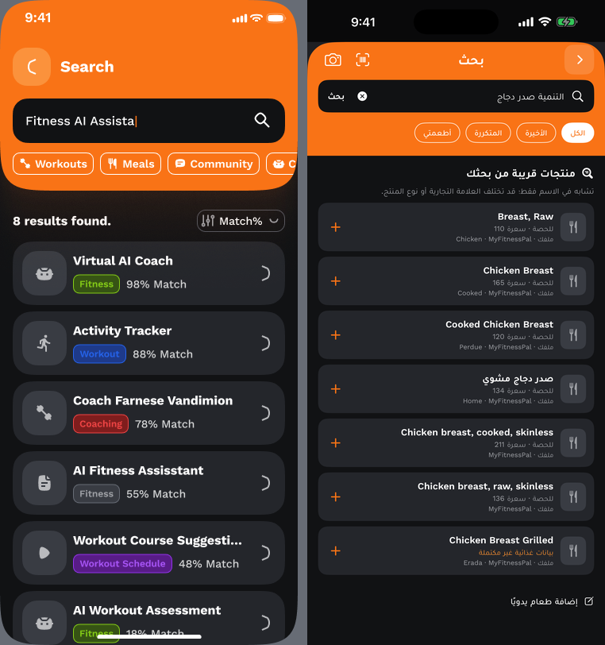

# حالة نقل تصميم Figma الأصلي — غير مكتمل

> هذا سجل تدقيق الاستخراج وخط الأساس قبل التعديل. متابعة الكود الجديدة وحالتها موثقة في [تنفيذ لقمة 2.4](IMPLEMENTATION-AR.md).

المصدر الوحيد للمواصفات البصرية هو [ملف Sandow الذي حدده المستخدم](https://www.figma.com/file/IfMCdTI3FcvXpNFy79PRUA?type=design). مصدر الوظائف والبيانات هو مشروع لقمة الحالي. هذا المجلد يوثّق الاستخراج والتدقيق والمقارنة الأولية؛ لا يحتوي على تنفيذ جديد لواجهات التطبيق.

## نتيجة الاتصال الفعلي

تم الاتصال بملف Figma الصحيح في 2026-10-16 وقراءة فهرس صفحاته الأربع عشرة. أُعيدت بيانات فعلية لثلاث لوحات:

| اللوحة الأصلية | Node | أبعادها داخل Figma |
|---|---|---|
| Diet & Nutrition Management | `2:10108` | 5460 × 2119.482421875 |
| Search Screen | `2:10112` | 2387 × 1292 |
| Profile Settings & Help Center | `2:10120` | 5899 × 2232.28759765625 |

أمثلة عناصر قابلة للقياس من المحتوى المتاح: `Top Nav` (`2:10015`) **343×48**، و`Button Primary Icon` (`2:10013`) **343×56**، و`iPhone X or newer` (`2:10019`) **375×44**. هذه أمثلة حقيقية، ولا تثبت أن كل شاشة متقدمة تستخدم المقاسات نفسها.

ألوان رُصدت في عناصر صفحة Welcome: **#111214، #393C43، #F97316**. الخط المرصود فيها **Work Sans** بأوزان Regular 400 وMedium 500 وSemiBold 600 وBold 700. ظهر **Chakra Petch Regular** في صفحة ترويجية أخرى؛ لا يُعامل كخط لواجهات التغذية. لم تُستخرج كل أحجام النصوص وارتفاعات السطور والتباعد أو نسخة ملفات الخط الأصلية.

تم تنزيل صور PNG الأصلية للوحات التغذية والبحث والإعدادات. تعرض كل لوحة مستهدفة عنصر IMAGE واحدًا في البيانات المسترجعة. الشاشات ظاهرة داخل الصور، لكن عناصرها الداخلية وأيقوناتها وصورها المنفصلة وAuto Layout وVariants لا تظهر كشجرة طبقات مستقلة في هذه النتائج. لا يعني ذلك غياب المحتوى المرئي أو إثبات غيابه عن كل صفحة غير مكتملة الفحص.

## القيد الذي أوقف الاستخراج

تجاوزت بعض نتائج جرد الصفحات حد استجابة الخادم البالغ 20,480 بايت. ثم أعادت الخدمة: “You've reached the Figma MCP tool call limit on the Starter plan.” الحساب المتصل أظهر View seat / Starter. لم تُنشر هوية الحساب أو روابط الأصول المؤقتة، ولم يُنفَّذ اشتراك مدفوع أو تجاوز للحد.

إكمال النقل الهندسي يحتاج استعادة إمكانية القراءة عبر Figma، ثم التحقق من وجود طبقات الشاشات والأصول المنفصلة القابلة للاستخراج. عودة الحصة وحدها لا تجعل الصورة المجمّعة طبقات مستقلة. لا تُحوَّل إحداثيات القص من الصور إلى مقاسات أصلية ولا يُستعاض عنها بتصميم تخميني.

## حالة المراحل التسع

| المرحلة | الحالة الفعلية |
|---|---|
| 1. استخراج Figma | جزئي: اتصال وفهرس 14 صفحة وثلاث لوحات وأمثلة عناصر فعلية؛ الجرد الشامل وVariants والقيود والأصول المنفصلة غير مكتملة |
| 2. فحص المشروع | تم تدقيق البنية والوظائف والبيانات والخدمات الحالية دون تعديلها؛ [التقرير](project-analysis.md) |
| 3. ربط الشاشات | تم إعداد خريطة الأدلة لكل وظائف التطبيق و30 منطقة مرئية داخل اللوحات؛ ليست إثباتًا لاستخراج 30 Frame؛ [الخريطة](screen-mapping.md) |
| 4. إدماج الأصول | حُفظت ثلاث صور مرجعية في التوثيق فقط؛ لم تُضف أصول إنتاج جديدة إلى التطبيق |
| 5. تنفيذ الواجهات | لم يبدأ تنفيذ جديد؛ خصائص عناصر الشاشات المستهدفة غير مكتملة |
| 6. ربط الوظائف | لم يُجرَ تغيير جديد؛ وظائف النسخة الحالية محفوظة في المصدر دون تعديل |
| 7. التحقق البصري | تدقيق فعلي للصور المرجعية ولقطات build59، مع Overlay وPixel Diff استكشافيين لشاشة البحث؛ لا مقارنة قبول أو SSIM أو نسبة مطابقة |
| 8. اختبار الوظائف | لم تُنفَّذ اختبارات تفاعل أو بناء جديدة لهذا التغيير التوثيقي؛ نتائج build59 السابقة لا تعني اختبار واجهة جديدة |
| 9. التسليم | حزمة أدلة ومراجعة مسودة على فرع مستقل؛ المهمة ومعايير قبولها ما زالت غير مكتملة، ولا دمج إلى main |

## نتائج المقارنة

النسخة الحالية تختلف في تقديم البحث كنافذة منبثقة، وSafe Area، وترويسة البحث، والفلاتر، ومحتوى الصفوف، وتجميع الإعدادات، وشكل بعض الأزرار. [تقرير الفروق](fidelity-findings.md) يفصل ما شوهد فعليًا وما يحتاج بيانات أصلية.

لقطة التطبيق أصلها 1320×2868 على iPhone 16 Pro Max، بينما المنطقة المرجعية 375×812 بكسل من لوحة مجمّعة. جرى توحيد العرض وقص ثلاثة بكسلات من الأسفل للعرض التشخيصي. اللغة والبيانات وSafe Area وحجم العرض المنطقي مختلفة. لذلك لا تعني الصور اختبارًا فعليًا على عرض 375 نقطة، ولا يصح احتساب نسبة مطابقة منها.

## الملفات والتسليم

- لا تعديلات جديدة على ملفات Swift أو الخدمات أو البيانات أو الخطوط أو الأيقونة أو إعدادات البناء.
- لا مكونات إنتاج جديدة ولا IPA جديد لهذا التدقيق.
- [إثبات الاتصال](connection-proof.json)، [جرد الأصول](asset-manifest.json)، [الإسناد](ATTRIBUTION.md)، [جاهزية البناء والتحقق](ci-assessment.md).
- تُحفظ بيانات المستخدم ومفتاح الاتصال خارج هذه الحزمة؛ المفتاح الخاص لا يُرفع للمستودع.

لتكرار المقارنة التشخيصية محليًا: شغّل `python compare_baseline.py` من بيئة يتوفر فيها Pillow. صور `native` والمرجع لا تُعدَّل؛ تنشأ النتائج داخل `baseline` مع تقرير البصمات والتحويلات. لم تُعلن مطابقة 100% أو نجاح تفاعلات لم تُختبر.
